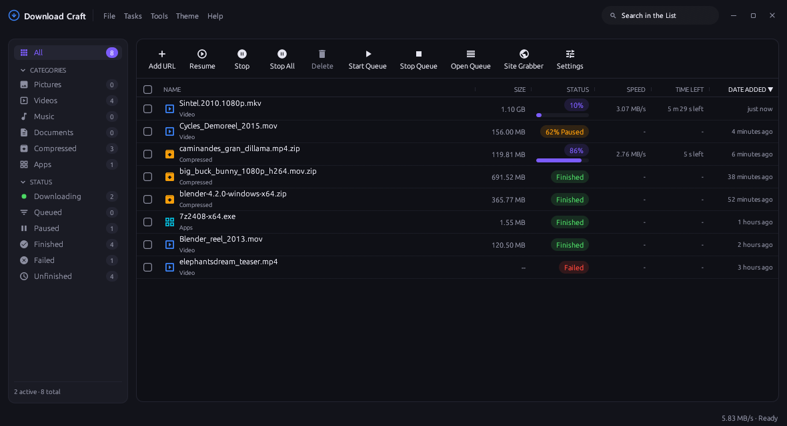
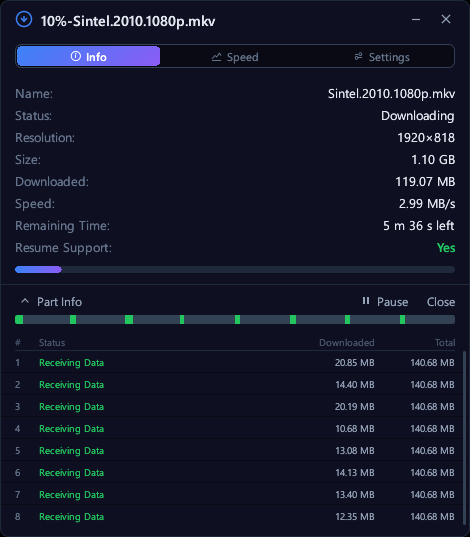
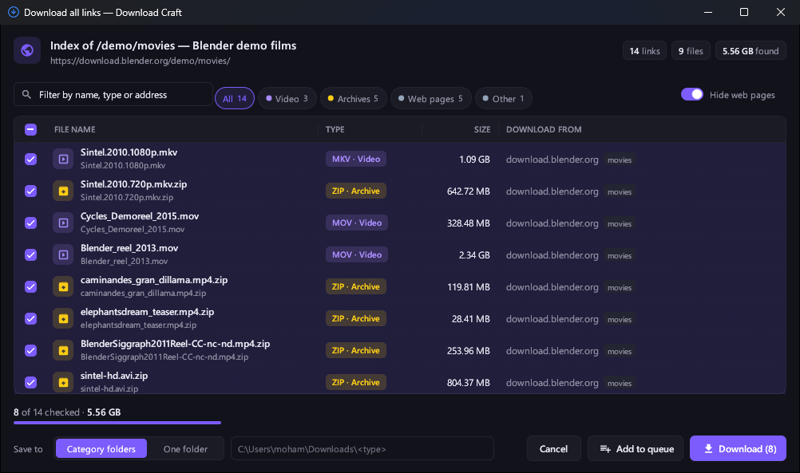
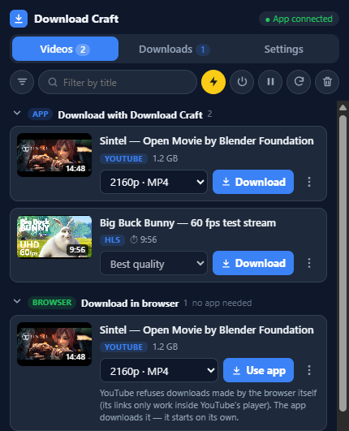
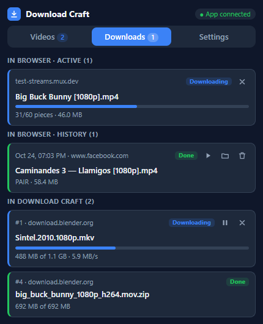
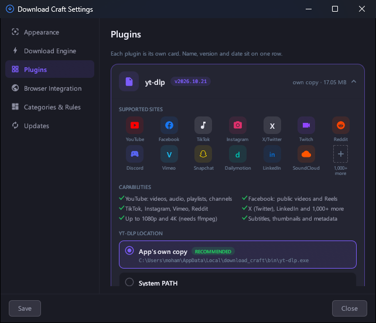
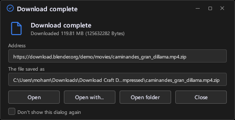

<div align="center">


# Download Craft

**A fast, free download manager — with a browser extension that catches the videos other tools miss.**

Multi-connection downloads, a queue and scheduler, YouTube and 1,000+ sites through its own
yt-dlp, and an extension that works with the app — or on its own.

[](https://github.com/hungry-detective/downloadcraft/releases/latest)
[](https://github.com/hungry-detective/downloadcraft/releases)
[](LICENSE)
[](https://www.rust-lang.org)

<br>

[](https://github.com/hungry-detective/downloadcraft/releases/download/v0.9.8/DownloadCraft-0.9.8-windows-x64-portable.zip)
&nbsp;
[](https://github.com/hungry-detective/downloadcraft/releases/download/v0.9.8/DownloadCraft-0.9.8-macos-Universal.zip)
&nbsp;
[](https://github.com/hungry-detective/downloadcraft/releases/tag/v0.9.8)

[](https://github.com/hungry-detective/downloadcraft/releases/download/v0.9.8/DownloadCraft-Chrome-0.9.8.zip)
&nbsp;
[](https://github.com/hungry-detective/downloadcraft/releases/download/v0.9.8/DownloadCraft-Firefox-0.9.8.xpi)

<sub>Windows 10/11 · macOS 12+ (Apple Silicon & Intel) · Linux x86-64 (DEB, RPM, AppImage) · <a href="https://github.com/hungry-detective/downloadcraft/releases">all releases</a></sub>

<br><br>



</div>

---

## ✨ What's new in 0.9.8

- **Download in the browser — no app needed.** The extension now saves videos by itself, like a
  stand-alone video downloader: plain files, separate video + audio joined into one MP4, and HLS / DASH
  streams (AES-128 HLS included). With the app running, the same cards hand downloads to Download Craft.
- **Download all links.** Right-click any page → *Download all links with Download Craft* to pick
  files from a folder listing or gallery, with types, sizes, filters and one-click queueing.
- **Facebook reels, done right.** One card per reel with every quality, its sound track and a real
  size — instead of dozens of nameless pieces.
- **Streams show honest progress.** HLS/DASH downloads count fragments instead of a size that keeps
  changing; temporary pieces stay in a hidden folder, and pausing/resuming no longer inflates sizes.
- **New extension popup** with a toolbar (filter, search, auto-send, detection on/off, pause all,
  rescan, clear) and a **Downloads** tab for browser and app downloads.
- **One-click JavaScript runtime** for yt-dlp in Settings → Plugins, resizable columns everywhere,
  and many fixes.

Full notes: [Release 0.9.8](https://github.com/hungry-detective/downloadcraft/releases/tag/v0.9.8).

---

## 📸 Screenshots

<table>
  <tr>
    <td width="55%" valign="top">
      
      <p><b>Capture a link</b> — the app checks its real name and size before it starts.</p>
    </td>
    <td width="45%" valign="top">
      
      <p><b>Watch it fly</b> — live speed, time left and every parallel connection.</p>
    </td>
  </tr>
</table>

<p align="center">
  <br>
  <b>Download all links</b> — every file on a page with its type and size; check, filter, download.
</p>

<table>
  <tr>
    <td width="50%" valign="top">
      
      <p><b>Extension popup</b> — every video on the page, with the app or in the browser alone.</p>
    </td>
    <td width="50%" valign="top">
      
      <p><b>Downloads tab</b> — browser downloads and the app's queue, side by side.</p>
    </td>
  </tr>
</table>

<p align="center">
  <br>
  <b>On every player</b> — a small <i>Download this video</i> bar, see-through until you need it.
</p>

<table>
  <tr>
    <td width="58%" valign="top">
      
      <p><b>Settings</b> — yt-dlp, FFmpeg and the JavaScript runtime install and update themselves.</p>
    </td>
    <td width="42%" valign="top">
      
      <p><b>Done</b> — open the file, open it with another app, or show its folder.</p>
    </td>
  </tr>
</table>

---

## 🚀 Features

**Downloading**
- Segmented downloads (1–16 connections) with resume, a global speed limit and per-download connections.
- Queue with concurrency limit, scheduler, retry-all-failed and finish actions (shutdown / sleep / hibernate).
- Smart names from the server or the video title; safe auto-rename or overwrite; optional SHA-256 check.
- HLS and DASH streams (live recording, AES-128), video + audio merged with FFmpeg.

**Video sites**
- YouTube and 1,000+ sites through the app's own **yt-dlp**, kept up to date automatically — 1080p, 4K
  and merged audio + video. A portable JavaScript runtime installs in one click.
- Facebook / Instagram reels, Vimeo, Bilibili and generic players detected from the page itself.

**Browser extension (Chrome, Edge, Brave, Firefox)**
- Catches videos from network traffic, manifests and page data — HLS, DASH, MP4/WebM, subtitles.
- *Download this video* bar on players, quality menus with sizes, right-click *Download all links*.
- Works **without the app**: downloads, joins and saves videos in the browser.

**App**
- System / Dark / Light themes, status sidebar, search, sortable and resizable columns, bulk actions.
- File names in any script (Bangla, Arabic, CJK …) with proper Indic shaping.
- Clipboard detection, notifications, tray icon, antivirus hook, and a CLI that shares the same queue.

---

## 📦 Install

| Platform | Download | How |
|---|---|---|
| **Windows 10/11** | `DownloadCraft-0.9.8-windows-x64-portable.zip` | Extract and run `download_craft.exe` — nothing to install. |
| **macOS 12+** | `DownloadCraft-0.9.8-macos-Universal.zip` | Move *Download Craft.app* to Applications (development build, not notarized — right-click → Open the first time). |
| **Ubuntu / Debian / Mint** | `downloadcraft_0.9.8_amd64.deb` | `sudo apt install ./downloadcraft_0.9.8_amd64.deb` |
| **Fedora** | `downloadcraft-0.9.8-1.x86_64.rpm` | `sudo dnf install ./downloadcraft-0.9.8-1.x86_64.rpm` |
| **Other Linux** | `DownloadCraft-0.9.8-x86_64.AppImage` | Make it executable and open it. |

**Browser extension**
1. **Chrome / Edge / Brave:** extract `DownloadCraft-Chrome-0.9.8.zip`, open `chrome://extensions`, turn on
   *Developer mode*, choose **Load unpacked** and pick the `browser-extension` folder.
2. **Firefox:** open `about:debugging#/runtime/this-firefox` → **Load Temporary Add-on…** → pick
   `DownloadCraft-Firefox-0.9.8.xpi`.
3. In the app, open **Settings → Browser Integration** and press **Install** for your browser, so the
   extension can talk to the app. (Without it, the extension still downloads in the browser.)

Your queue and settings live in `%APPDATA%\download_craft` (Windows) and carry over between versions.

---

## 🛠️ Build from source

Prerequisites: [Rust stable](https://www.rust-lang.org/tools/install) (MSVC build tools on Windows).

```powershell
cargo build --release   # target\release\download_craft.exe (portable)
cargo test              # unit + local HTTP engine tests (no network needed)
node --test browser-extension/*.test.js   # extension tests
```

Packaging: `python scripts/package.py --platform windows --arch x64` (see [PORTABLE-BUILDS.md](PORTABLE-BUILDS.md)
for macOS and Linux).

**Command line:** `download_craft.exe add "https://example.com/file.zip"`,
`download_craft.exe get "https://example.com/file.zip" -o out.zip`, `download_craft.exe --help`.

---

## 📄 License

MIT — free for open-source, closed-source and commercial use. See [`LICENSE`](LICENSE);
[`NOTICE.md`](NOTICE.md) lists the bundled third-party assets (Material Icons, fonts).

<div align="center"><sub>Screenshots use Blender Foundation open movies (CC BY) and public test streams.</sub></div>
