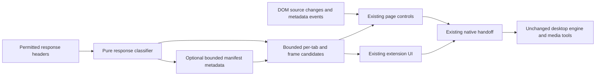

# Original media detection design and implementation

Dates: 2026-10-22–23. This design is independently implemented in the existing extension. It uses public WebExtensions APIs and HLS relationships; it does not import code/assets, private protocols or dependencies from the supplied reports. The reference inventory and evidence confidence are in [MEDIA_DETECTION_ANALYSIS.md](MEDIA_DETECTION_ANALYSIS.md).

## Architecture retained



No new production permission, content-script world, browser process, offscreen document, DNR rule or privileged transport is introduced. Browser interception remains a separate controller with its existing acknowledgement/fallback protections. Test-only DevTools use is outside the shipped extension and is not a production permission.

## 1. Response evidence instead of broad URL guessing

`DCRank.mediaResponse(details, minSizeKB)` is a pure function, shared with Node fixtures. It admits successful GET responses from `media`, `xmlhttprequest`, `other`, `main_frame`, `sub_frame` and `object`. HTTP(S), safe URL parsing and absence of URL credentials are required. A real video/audio/manifest MIME is strong evidence. Missing/generic binary MIME needs an explicit media path or manifest indicator; explicit non-media MIME is rejected. Opaque HLS MIME variants and DASH MIME remain manifests. Content-Range's whole-file length is used for 206 size filtering; configured zero is honored.

The result is only `{url,mime,size,kind}`. It does not infer playable duration, codecs, integrity or media completeness from a filename. A successful redirect target is observed independently; redirect/error responses themselves are not offered as videos. Small manifests and recognizable segments are not discarded by a whole-file size gate. Segment classification remains distinct from a complete-file download.

These choices use the documented [Chrome response observation API](https://developer.chrome.com/docs/extensions/reference/api/webRequest) and compatible [Firefox event](https://developer.mozilla.org/en-US/docs/Mozilla/Add-ons/WebExtensions/API/webRequest/onHeadersReceived), within existing host permissions.

## 2. Provenance, freshness and navigation lifetime

Each observation retains the exact URL, MIME, size, frame, available document ID/page URL and timestamp. A repeated URL in the same frame/document updates metadata rather than returning early. The same URL in different frames remains separately attributable; signed query strings are not canonicalized away for transfer.

Before any settings read or manifest probe, a candidate captures the current per-tab session object. Tab navigation/removal deletes that object. Async completions must still match its identity before updating candidate state, so old work cannot repopulate a new page. Loading events without a URL also invalidate state. This is an in-memory lifetime guard, not cross-worker persistence.

Content-script `getMedia` requests use the browser-provided sender tab/frame/document and reject explicit page mismatches. They do not trust a requested alternate tab ID or fall back to unrelated tab-wide media. Extension-origin pages may deliberately query their selected tab; they are distinguished from website senders even when both have `sender.tab`.

Adaptive handoff looks up the requesting frame/document when supplied. A shared URL with multiple possible captures cannot select the first iframe arbitrarily. Internal source-context fields are used for lookup only; they do not extend the desktop native-message schema.

## 3. Optional manifest inspection with hard bounds

The original response is recorded immediately. Enrichment never gates visibility or cancels browser traffic. Work is bounded as follows:

| Resource | Bound |
| --- | --- |
| Metadata fetch concurrency | 2 per tab, 4 across active sessions |
| Probe identity | Exact URL plus frame; no token stripping |
| Probe cache | At most 32 keys per tab/session; 15-second reuse, including failed probes |
| Response body | 1 MiB maximum; enforce actual streamed bytes before decoding an oversized chunk |
| Request timeout | 8 seconds |
| Redirect behavior | Optional re-fetch rejects redirects; original observed candidate remains |
| HLS references | At most 512 unique HTTP(S) references; no credential-bearing targets |
| Candidate list | Existing maximum 25 per tab retained |

Settings/storage reads are avoided for obviously unrelated responses. Concurrent identical observations share a metadata promise. Repeated unchanged playback/range observations update their in-memory timestamp without rewriting the snapshot or badge; actual MIME/size/manifest evidence changes still publish. Budget exhaustion or read failure simply skips enrichment. Readers are cancelled on completion/overflow. No decryption key, segment payload or unrelated URL is fetched by the metadata parser.

Native Edge confirms the observer can detect a normal HLS/DASH response while preserving the exact signed manifest URL. Tests cover oversized/failed enrichment and navigation while asynchronous work is pending. Cache reuse is a metadata optimization, not a guarantee that a live playlist or signed token remains valid for 15 seconds.

## 4. Evidence-based HLS relationships

`playlistReferences` requires an HLS header. It extracts media-playlist/segment lines and URI attributes from public rendition, I-frame and initialization-map tags. It does not treat key/session-key URIs, arbitrary text or unrelated XML as media children. Relative URI resolution follows normal URL rules, including preserving explicitly supplied child tokens without inventing inherited authentication query parameters. Public [RFC 8216](https://www.rfc-editor.org/rfc/rfc8216.html) specifies the relevant playlist/rendition concepts.

`completePlaylist` follows explicit child-reference paths within compatible provenance. It returns a unique outer root when supported by that evidence. Shared children, cycles and multiple unrelated roots do not pick an arbitrary master. A selected complete manifest remains itself when root evidence is ambiguous; a loose fragment must use the existing exact single-player-page recovery path or be refused.

Alternate audio and quality references stay associated with their real master. They are not guessed as independent pairs from temporal proximity, filename similarity, same CDN or merely sharing a frame. Existing engine quality selection and FFmpeg merging are preserved; a new language/track selector and full DASH browser parser are outside this implementation.

## 5. Dynamic-page refresh without a new polling loop

The existing 400 ms debounce now also observes media `src`, `poster`, `type` and `controls` attributes. Attribute changes on unrelated elements do not schedule media work. Captured `loadedmetadata` events refresh a selected `currentSrc` even when no child was inserted. Superseded content generations stop refreshing. Existing DOM insertion handling, overlay placement, close controls and periodic fallback behavior remain.

The actual Edge smoke changes an audio player's source and checks that the extension's control key is rebound to the new source. Unit tests verify debouncing and ignoring unrelated image changes. No universal fetch/XHR monkey-patch or generic page-global object scan was added.

## Validation and reproduction

Final extension unit/regression suite: **157 passed, 0 failed/skipped**, up from 123 at the Phase 2 checkpoint. All extension JavaScript parses; Python test tools compile. All implementation commits were checked with relevant tests and diff review.

From the repository:

```text
node --test browser-extension/*.test.js
python scripts/package_extensions.py --output dist/phase3-extensions
python scripts/media_detection_smoke.py --browser "C:/Program Files (x86)/Microsoft/Edge/Application/msedge.exe"
```

The native smoke needs installed FFmpeg/ffprobe, Node 22+ and a supported Chromium-family executable. `--edge` remains an alias for older test commands. It creates generated media, a loopback server, a staged test-only extension and a unique browser profile under ignored `dist/`. It disables native messaging in that staged manifest and automatic capture in that profile. It closes its browser/server at the end; it does not install into or change the normal browser profile. The DevTools adapter waits for extension-page readiness; it is test orchestration, not media-detection code.

Final native checks all pass in **Edge 156.0.4314.42** and **Brave (executable product version 155.1.97.57)**, separately:

1. Direct MP4 response.
2. Native audio response.
3. Permitted cross-origin embedded video/frame.
4. HLS manifest, with exact query token.
5. DASH manifest.
6. Binary/HTML/error fixtures excluded.
7. Download this audio control.
8. Download this video control.
9. Audio control follows a dynamic source change.

An earlier native attempt revealed the extension-page/sender-tab distinction; the fix is regression-tested and included. Failed harness/debug logs are retained alongside the final passing evidence. The test-generated MP4's audio/video streams are ffprobe-verified, but desktop download/merge success is **not** asserted. Browser handoff is intentionally disabled in this native smoke; previous takeover regression harnesses still pass.

Chromium and Firefox packages are version-aligned at **0.9.7.3**, and fixture/test code is excluded from production staging. Firefox XPI is unsigned. Native Chrome/Firefox and Linux/macOS compatibility remain unverified here. Rust/Cargo sources and desktop version are untouched; the prior Cargo build blocker still applies.

## Deferred experiments and acceptance gates

- **Resource Timing hints:** potentially useful for pre-injection/cache gaps, but [Resource Timing](https://developer.mozilla.org/en-US/docs/Web/API/PerformanceResourceTiming) names lack dependable MIME/completeness/track evidence. Do not auto-promote every entry to downloadable media. Any prototype needs bounded batches, sender/frame trust and explicit evidence levels before enabling it.
- **Page-world/site adapters:** require a clearly supported site, documented/lawful input, strict message validation and stale-page tests. No reported private site algorithm or reference bridge is imported.
- **MV3 hydration:** implement bounded session-only persistence with tab/document validation, private-context handling and worker-restart fixtures before activation. Avoid reviving expired or navigated-away detections.
- **Track UI:** use validated native extractor/manifest output rather than guess pairs in the browser. yt-dlp's public [format documentation](https://github.com/yt-dlp/yt-dlp#format-selection) provides a compatible existing component, but native builds and real output checks are required.
- **Complete media/recovery:** provision the Rust toolchain and validate actual download, FFmpeg merge, cancellation/cleanup, expiry and resume behavior separately. No DRM bypass, proprietary muxer or new credential replay mechanism is proposed.

Unverified experiments are not enabled in the production extension. The shipped local changes are the bounded detection/provenance improvements tested above.
